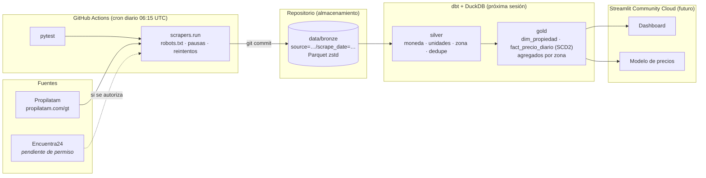

# GT House Market

Pipeline de datos **serverless** que recolecta a diario la oferta inmobiliaria de la
Ciudad de Guatemala, guarda su historia en el tiempo y la prepara para analizar
precios por zona y entrenar un modelo de regresión de precios.

Todo vive en este repositorio: GitHub Actions orquesta, Parquet en `data/` es el
almacenamiento (patrón [*git scraping*](https://simonwillison.net/2020/Oct/9/git-scraping/))
y dbt + DuckDB transforma en capas Medallion.

> **Estado:** sesión 1. Ya existen la capa bronze, el scraper de Propilatam y el
> cron diario. dbt (silver/gold), el modelo y el dashboard vienen después.

## Arquitectura



### Capas

| Capa | Contenido | Estado |
|---|---|---|
| **Bronze** | Lo extraído tal cual + `run_id`, `scraped_at`, `source`. Un Parquet por corrida y fuente. | ✅ |
| **Silver** | Moneda normalizada (GTQ/USD), m² vs varas², venta vs alquiler, zona desde texto libre, deduplicación. | ⏳ |
| **Gold** | `dim_propiedad`, `fact_precio_diario` (historial tipo SCD), agregados por zona (precio/m², días publicado, bajas de precio). | ⏳ |

### Layout de bronze

```
data/bronze/
└── source=propilatam/
    └── scrape_date=2026-10-24/
        └── run_061503Z.parquet
```

Particionado estilo Hive, para que DuckDB lo lea directo:

```sql
SELECT * FROM read_parquet('data/bronze/*/*/*.parquet', hive_partitioning = true);
```

## Fuentes y ética de scraping

| Fuente | Estado | Notas |
|---|---|---|
| [Propilatam](https://www.propilatam.com/gt) | Activa | `robots.txt` permite todo; los T&C no prohíben la recolección automatizada. Catálogo de **proyectos nuevos** (≈48 en venta, oct-2026), con rangos de precio por proyecto. |
| [Encuentra24](https://www.encuentra24.com/guatemala-es) | **No se scrapea** | Sus [Términos](https://www.encuentra24.com/terms-gt) (cláusula 18) prohíben expresamente bots y scraping sin autorización, y el sitio usa un challenge anti-bot. Se solicitó permiso por escrito. |

Reglas que sigue el scraper ([`scrapers/common/http.py`](scrapers/common/http.py)):

- **User-Agent identificable**, con la URL de este repo como contacto.
- Revisa **`robots.txt`** antes de cada host y no pide rutas prohibidas.
- Deja **5–10 s con jitter** entre peticiones y hace una sola corrida al día.
- Los **reintentos** con backoff exponencial son solo para errores transitorios (timeouts, 5xx).
- **Ante un 403, un 429 o un challenge se detiene.** No intenta evadir protecciones (ni proxies, ni rotación de UA, ni headless).
- **Minimización de datos**: no guarda HTML crudo, fotos, descripciones largas ni datos de contacto de personas.

## Cómo correrlo en local

Requiere Python 3.11+.

```bash
python -m venv .venv
source .venv/bin/activate          # Windows: .venv\Scripts\activate
pip install -r requirements.txt

# Tests
python -m pytest -q

# Corrida de prueba sin escribir archivos
python -m scrapers.run --source propilatam --dry-run

# Corrida real: escribe data/bronze/source=propilatam/scrape_date=<hoy>/run_<hora>Z.parquet
SCRAPER_CONTACT_URL="https://github.com/<usuario>/gt-house-market" \
  python -m scrapers.run --source propilatam
```

Códigos de salida de `scrapers.run`: `0` corrida completa · `1` error o corrida parcial ·
`2` bloqueado / robots.txt · `3` sin filas.

Para inspeccionar lo recolectado:

```bash
python -c "import pyarrow.parquet as pq; t = pq.read_table('data/bronze'); print(t.num_rows, 'filas'); print(t.schema)"
```

## Orquestación

- [`scrape.yml`](.github/workflows/scrape.yml) corre a diario. También se puede lanzar a mano con *Run workflow*, que tiene una opción `dry_run`. Primero corre los tests, luego el scraper (una entrada de matriz por fuente) y commitea solo si hay Parquet nuevo. Deja un resumen de cada corrida en la pestaña *Summary*.
- [`ci.yml`](.github/workflows/ci.yml) corre los tests en cada push o PR que cambie código.

## Estructura del repo

```
.github/workflows/   scrape.yml (cron) · ci.yml (tests)
scrapers/
  common/            http.py (cliente educado) · storage.py (Parquet) · models.py
  sources/           propilatam.py · registro de fuentes en __init__.py
  run.py             CLI
tests/               tests del parser, storage y detección de bloqueos
data/bronze/         Parquet particionado (lo escribe el bot)
dbt/  ml/  app/      próximas sesiones
```

## Agregar una fuente

1. Crea `scrapers/sources/<fuente>.py`, que exponga `NAME`, `SCHEMA` (pyarrow) y `scrape(session, run_id, scraped_at)`.
2. Regístrala en `scrapers/sources/__init__.py`.
3. Agrégala a la matriz `source` de `scrape.yml`.
